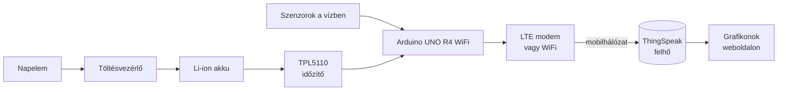

# 💧 Vízérzékelő doboz

**Napelemes, mobilhálózaton adatot küldő vízminőség-mérő állomás folyókba – iskolai projekt.**

A doboz a folyó partján (vagy a vízben) áll, negyedóránként megméri a víz legfontosabb
jellemzőit, és az eredményeket az interneten keresztül egy nyilvános weboldalra küldi,
ahol bárki grafikonon követheti a folyó állapotát.

| Mit mér?                         | Mivel?                                  |
|----------------------------------|-----------------------------------------|
| Vízhőmérséklet                   | DS18B20 vízálló hőmérő                  |
| pH (savasság / lúgosság)         | analóg pH szonda + erősítő              |
| Vezetőképesség (EC) és TDS       | analóg TDS/EC szenzor                   |
| Zavarosság                       | optikai zavarosság szenzor              |
| Oldott oxigén *(opcionális)*     | galvanikus DO szonda                    |
| Doboz páratartalma (beázásjelző) | BME280 (Qwiic)                          |
| Akkufeszültség                   | feszültségosztó                         |



> **Állapot:** tervezési fázis (verzió: lásd [CHANGELOG.md](CHANGELOG.md)) – a firmware lefordul az UNO R4 WiFi-re, de a hardvert
> még nem építettük meg és nem teszteltük. A tapasztalatok alapján a dokumentáció változni fog.

> **Interaktív bemutató:** nyisd meg a [`weboldal/index.html`](weboldal/index.html) fájlt egy
> böngészőben – kattintható ábrán szétszedheted a dobozt, és lejátszhatod, mi történik benne egy
> mérés alatt. (Terv és további lépések: [weboldal/TERV.md](weboldal/TERV.md).)

---

## 📁 Mappaszerkezet

```
Vizerzekelo/
├── README.md                ← ez a fájl
├── CHANGELOG.md             ← verziók, változások
├── docs/                    ← részletes dokumentáció (sorrendben olvasandó)
│   ├── 01_projekt_attekintes.md
│   ├── 02_rendszerterv.md
│   ├── 03_szenzorok.md
│   ├── 04_energiaellatas.md
│   ├── 05_kommunikacio.md
│   ├── 06_mechanika_es_telepites.md
│   ├── 07_osszeszereles.md
│   ├── 08_kalibracio_es_karbantartas.md
│   ├── 09_biztonsag.md
│   ├── 10_tovabbfejlesztes.md
│   ├── 11_oktatasi_segedlet.md
│   ├── 12_oktatasi_szenzorok.md  ← olcsó szenzorok tanuláshoz, bemutatáshoz
│   ├── 13_vezerlok_osszehasonlitasa.md  ← UNO R4 WiFi, Nano 33 IoT, Nano RP2040 Connect
│   ├── szotar.md            ← fogalomtár diákoknak
│   └── kepek/               ← fényképek, rajzok
├── hardware/
│   ├── alkatreszlista.md    ← mit kell megvenni (BOM)
│   ├── beszerzes.md         ← hol lehet megvenni (magyar webshopok)
│   └── bekotes.md           ← lábkiosztás, kapcsolási rajzok
├── firmware/
│   ├── README.md            ← fordítás, feltöltés, beállítás
│   ├── vizerzekelo/         ← a fő program (Arduino sketch)
│   └── tesztek/             ← kis tesztprogramok: 01–06 terepi alkatrészek,
│                              07–11 olcsó / barkács oktatási szenzorok
├── tools/
│   ├── energia_kalkulator.py   ← akku / napelem méretezés
│   └── thingspeak_letoltes.py  ← mért adatok letöltése CSV-be, statisztika
├── weboldal/                ← interaktív bemutató oldal (index.html, build nélkül)
└── adatok/                  ← letöltött mérési adatok helye
```

## 🚀 Hogyan kezdjünk hozzá?

1. **Olvasd el** a [projekt áttekintést](docs/01_projekt_attekintes.md) és a [biztonsági szabályokat](docs/09_biztonsag.md).
2. **Szerezd be** az alkatrészeket: [alkatreszlista.md](hardware/alkatreszlista.md).
3. **Építs lépésről lépésre** az [összeszerelési útmutató](docs/07_osszeszereles.md) szerint – minden
   alkatrészt előbb a saját [tesztprogramjával](firmware/tesztek/) próbálj ki.
4. **Töltsd fel** a fő programot: [firmware/README.md](firmware/README.md).
5. **Kalibráld** a szenzorokat: [kalibráció](docs/08_kalibracio_es_karbantartas.md).
6. **Telepítsd** a dobozt: [mechanika és telepítés](docs/06_mechanika_es_telepites.md).

## 👩‍🏫 Iskolai felhasználás

A projekt felső tagozatos (10–14 éves) diákok bevonásával, **felnőtt felügyelet mellett** készül.
Az [oktatási segédlet](docs/11_oktatasi_segedlet.md) foglalkozásonkénti tervet, kísérleteket és
tantárgyi kapcsolódásokat tartalmaz. Az [olcsó oktatási szenzorok](docs/12_oktatasi_szenzorok.md)
fejezet mutatja meg, hogyan lehet a drága terepi szenzorok helyett csoportonként kb. 10–14 ezer
Ft-ból kísérletezni (NTC hőmérő, barkács vezetőképesség-mérő, vöröskáposztás pH mérés stb.).
A [szótár](docs/szotar.md) elmagyarázza a szakszavakat.

## ⚠️ Biztonság röviden

- Vízparton **soha nem dolgozik diák egyedül**, csak felnőtt jelenlétében, a vízbe diák nem megy be.
- A Li-ion akkuval, forrasztással és vegyszerekkel (oldott oxigén szonda elektrolitja) **csak felnőtt** dolgozik.
- Folyóba eszközt helyezni **engedélyköteles lehet** – lásd [09_biztonsag.md](docs/09_biztonsag.md).

## 📜 Licenc (javaslat)

A git repó létrehozásakor érdemes licencet választani, pl. a kódra **MIT**, a dokumentációra
**CC BY-SA 4.0** – így más iskolák is szabadon felhasználhatják és továbbfejleszthetik.
