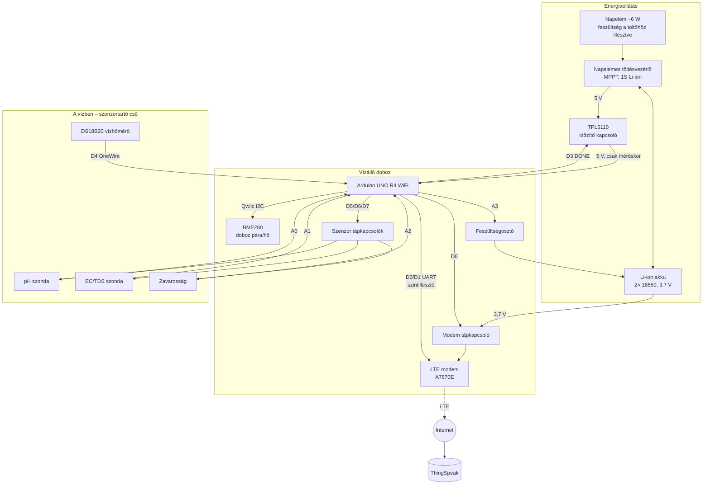
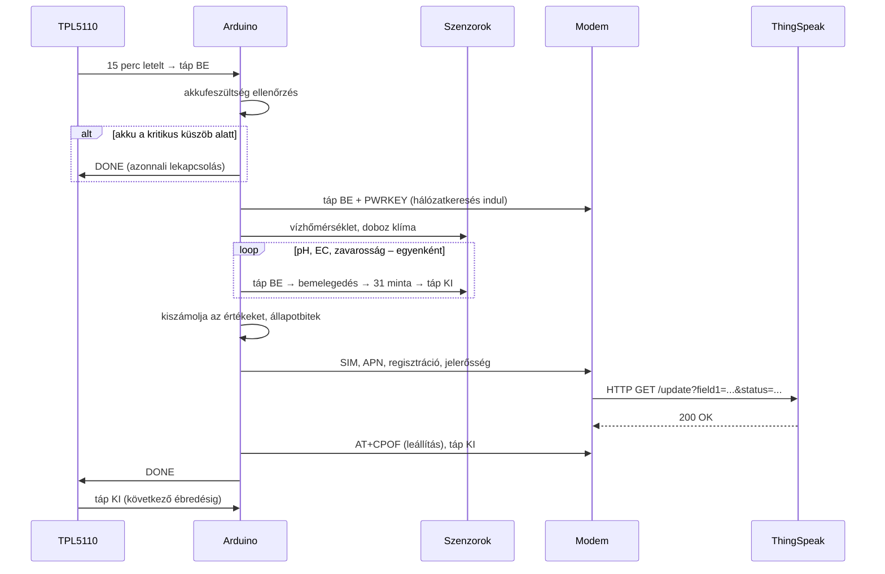
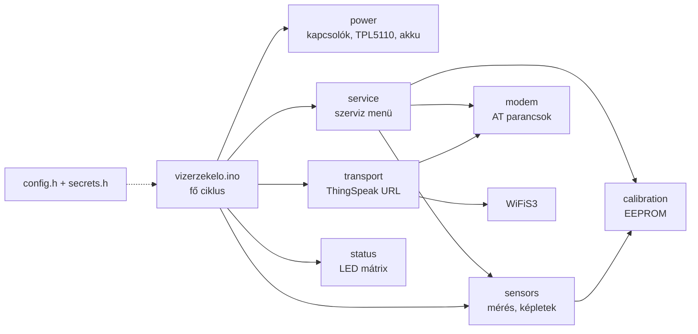

# 2. Rendszerterv

## 2.1 Blokkdiagram

## 2.2 A működési ciklus

A doboz **nem fut folyamatosan**. Az idő 99%-ában az Arduino teljesen ki van kapcsolva,
csak a TPL5110 időzítő „ketyeg” (kb. 35 nA fogyasztással – ez gyakorlatilag nulla).

Egy ciklus tipikusan **40–90 másodperc**, ebből a leghosszabb a hálózatra csatlakozás.

## 2.3 Fontos tervezési döntések – és miért

### Miért kapcsoljuk le teljesen az Arduinót? (TPL5110)
Az UNO R4 WiFi lapon a fő processzoron kívül egy ESP32-S3 WiFi chip, feszültségszabályzók és
LED-ek is vannak. Ezek „alvó” módban is együtt több tíz mA-t fogyasztanak – ez egy 3400 mAh-s
akkut néhány nap alatt lemerítené. A TPL5110 egy apró időzítő IC, ami a mérések között
**teljesen elveszi a tápot**, így a fogyasztás nanoamper nagyságrendű. Az ára: az Arduino
minden ébredéskor „újraindul”, nem emlékszik semmire – ezért a kalibrációt az EEPROM-ban
tároljuk, az időbélyeget pedig a ThingSpeak szerver adja.

### Miért kap a szenzorok közül egyszerre csak egy tápot?
A szondák ugyanabba a vízbe merülnek, és a víz vezeti az áramot. A TDS/EC szenzor váltakozó
feszültséggel méri a vezetést, ami „áthallatszik” a nagyon érzékeny pH szondába, és elrontja a
mérését. Két védelmet használunk együtt: (1) egyszerre mindig csak egy szenzor kap tápot, és (2) a
terepi dobozban a TDS/EC szenzor egy **galvanikus leválasztó modulon** át csatlakozik – ez a
gyártó által ajánlott megoldás. Hogy a zavarás tényleg megszűnt-e, azt az összeszereléskor
egy egyszerű próbával ellenőrizzük ([07_osszeszereles.md](07_osszeszereles.md), „Zavarás-próba”).

### Miért LTE Cat-1 modem, és nem a régi 2G (SIM800L)?
A 2G (GSM) modemek nagyon olcsók, de a mobilszolgáltatók Európa-szerte fokozatosan
lekapcsolják a 2G és 3G hálózatokat. Egy hosszú távra tervezett eszköznél ezért az LTE
(4G) a biztonságos választás. Az A7670E modem LTE Cat-1 kategóriás, és – ahol még van – 2G-re
is vissza tud lépni. Összehasonlítás: [05_kommunikacio.md](05_kommunikacio.md).

### Miért ThingSpeak?
- Ingyenes kis, nem kereskedelmi projekteknek, regisztráció után azonnal működik.
- Egyszerű HTTP kéréssel lehet adatot küldeni (nem kell titkosítást, bonyolult protokollt
  kezelni – egy AT paranccsal megoldható).
- Beépített grafikonok, nyilvános csatorna, CSV letöltés, MATLAB elemzés.
- 8 adatmező + 1 szöveges állapotmező csatornánként – pont elég.

### Miért 5 V-os USB-n kapja a tápot az Arduino?
A TPL5110 kimenetét egy USB-A aljzatba vezetjük, onnan egy szabványos USB kábel megy az
Arduinóba. Így a lap saját védőáramkörei működnek, és szervizeléskor egyszerűen kihúzzuk
a kábelt, és a laptopot dugjuk a helyére – nincs veszélye annak, hogy két táp egymásba dolgozik.

### Miért közvetlenül az akkuról kapja a tápot a modem?
A mobilmodemek adáskor rövid ideig akár **2 A**-es áramcsúcsot is felvehetnek. A modem-chipeket
eleve Li-ion akkuról való működésre tervezték (3,4–4,2 V), így a legegyszerűbb és legbiztosabb,
ha közvetlenül az akkuról, egy lágyan induló kapcsoló-MOSFET-en át táplálunk, az akku mellé tett
nagy puffer kondenzátorral. Az 5 V-os ág így nem terhelődik túl.

## 2.4 A firmware felépítése

- **Minden beállítás egy helyen** van (`config.h`), a jelszavak külön (`secrets.h`, nem kerül gitbe).
- A szenzorok ki-be kapcsolhatók (`USE_PH 0` stb.) – a hiányzó szenzor nem okoz hibát.
- Az adatküldés módja egy sorral állítható: `TRANSPORT_NONE` / `TRANSPORT_WIFI` / `TRANSPORT_GSM`.
- Ha nincs TPL5110 (pl. USB-ről megy a tesztpadon), a program maga vár a következő mérésig.

### Állapotbitek (status mező)

| Szöveg | Jelentés | Teendő |
|---|---|---|
| `OK` | minden rendben | – |
| `SZIVARGAS` | a doboz páratartalma > 80% | azonnal ellenőrizni, szilikagél csere, tömítés |
| `AKKU_GYENGE` | akku a figyelmeztető küszöb alatt (GSM módban 3,65 V, WiFi módban 3,5 V) | napelem tiszta? árnyék? mérési gyakoriság csökkentése |
| `AKKU_KRITIKUS` | akku a kritikus küszöb alatt (GSM: 3,5 V, WiFi: 3,3 V). A doboz ilyenkor nem mér és **nem is küld**, ezért ez az üzenet a ThingSpeaken **nem jelenik meg** – csak a soros monitoron és a LED mátrixon (X). Távolról a jele: `AKKU_GYENGE` üzenetek után elmaradnak az adatok | akkucsere / töltés |
| `VIZHOMERO_HIBA` | nincs DS18B20 jel | kábel, csatlakozó |
| `DOBOZSZENZOR_HIBA` | nincs BME280 | Qwiic kábel |
| `PH_HIBA`, `EC_HIBA`, `ZAVAROSSAG_HIBA`, `DO_HIBA` | a szenzor jele értelmetlen | kábel, szonda, kalibráció |
| `NINCS_KALIBRALVA` | még gyári kalibrációs értékek | kalibrálás a szerviz menüben |
| `SZERVIZ_JUMPER` | a szerviz jumper bent maradt; a doboz mér, de szerviz módba nem lép | a jumpert ki kell venni |

## 2.5 Lábkiosztás röviden

| Láb | Funkció | | Láb | Funkció |
|---|---|---|---|---|
| D0/D1 | modem UART | | A0 | pH |
| D2 | szerviz jumper | | A1 | EC/TDS |
| D3 | TPL5110 DONE | | A2 | zavarosság |
| D4 | DS18B20 | | A3 | akkufeszültség |
| D5/D6/D7 | pH / EC / zavarosság táp | | A4 | oldott oxigén (opc.) |
| D8 | modem táp | | Qwiic | BME280 |
| D9 | modem PWRKEY | | | |
| D10 | DO táp (opc.) | | | |

Részletes bekötés és kapcsolási rajzok: [../hardware/bekotes.md](../hardware/bekotes.md).
