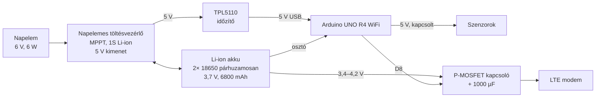

# 4. Energiaellátás

## 4.1 A tápellátás felépítése



| Rész | Feladat | Javasolt típus |
|---|---|---|
| Napelem | napfényből áram | 6 V, 6 W (vagy 10 W) monokristályos, kültéri, UV-álló |
| Töltésvezérlő | akku töltése, védelme, 5 V előállítása | 1S Li-ion napelemes töltő MPPT-vel, 5 V ≥ 1 A kimenettel (pl. DFRobot Solar Power Manager 5V, Waveshare Solar Power Manager) |
| Akku | energiatárolás éjszakára, borús napokra | 2 db védett (PCB-s) 18650 Li-ion cella párhuzamosan, márkás (pl. 3400 mAh) |
| TPL5110 | a mérések közti teljes lekapcsolás | Adafruit TPL5110 Low Power Timer Breakout |
| Modem kapcsoló | a modem tápjának ki-bekapcsolása | P-csatornás logikai MOSFET + NPN tranzisztor (lásd [bekotes.md](../hardware/bekotes.md)) |

> A konkrét modul vásárlása előtt **mindig ellenőrizd az adatlapot:** bemeneti feszültség
> (illeszkedik-e a napelemhez), kimeneti áram, mélykisütés-védelem, és van-e hőmérséklet-figyelés.

## 4.2 Energiamérleg

Az alábbi táblázatot a [`tools/energia_kalkulator.py`](../tools/energia_kalkulator.py) program
számolta ki **becsült** áramfelvételekkel. Ha megépült a doboz, mérd meg a valódi értékeket,
írd be a programba, és futtasd újra!

```bash
python3 tools/energia_kalkulator.py --intervallum 15 --akku 6800 --napelem 6
```

### Egy mérési ciklus (GSM mód)

| Fogyasztó | Áram | Idő | Energia | Arány |
|---|---|---|---|---|
| Arduino (5 V, 85% hatásfokú átalakítással) | ~90 mA | 75 s | 11,0 mWh | 52% |
| Szenzorok (egyszerre egy) | ~30 mA | 15 s | 0,7 mWh | 3% |
| LTE modem (3,8 V, átlag) | ~150 mA | 60 s | 9,5 mWh | 45% |
| **Összesen** | | | **21,3 mWh** | |

### Napi fogyasztás és tartalék

| Mérési időköz | Napi fogyasztás | Kibírja napfény nélkül (6800 mAh, 80%) |
|---|---|---|
| 15 perc (GSM) | **2,1 Wh** | **≈ 10 nap** |
| 30 perc (GSM) | 1,05 Wh | ≈ 19 nap |
| 15 perc (WiFi) | 1,0 Wh | ≈ 20 nap |

### Napelem termelés (6 W panel, 35° dőlés, déli tájolás, 60% rendszerhatásfok)

| Hónap | Termelés Wh/nap | Mérleg (15 perces mérés) |
|---|---|---|
| december (legrosszabb) | 4,7 | +2,6 |
| január | 5,8 | +3,7 |
| november | 6,1 | +4,1 |
| március / október | 13,3 / 10,8 | bőven |
| június–július | 20–21 | bőven |

**Következtetés:** havi átlagban a 6 W-os panel egész évben fedezi a fogyasztást. A veszélyes
időszak a **decemberi–januári hosszú, ködös, borult periódus**, amikor napokig szinte nincs
termelés – ezt az akku kb. 10 napos tartaléka hidalja át. Ha ennél hosszabb kiesésre kell
számítani, vagy árnyékos a hely:
- **10 W-os panel**, vagy
- télen **30 perces** mérési időköz (TPL5110 ellenállás cseréje), vagy
- nagyobb akku (3–4 cella párhuzamosan).

> **Pontos napsütés-adat a saját helyszínre:** PVGIS (az EU ingyenes napenergia-kalkulátora):
> <https://re.jrc.ec.europa.eu/pvg_tools/> – a térképen rákattintasz a helyszínre, és havonta
> megmondja a várható termelést.

## 4.3 Akku választás

| Szempont | Li-ion (18650) | LiFePO4 | Ólom zselés (12 V) |
|---|---|---|---|
| Energiasűrűség | ✅ nagy | közepes | ❌ kicsi, nehéz |
| Ár, beszerezhetőség | ✅ olcsó, mindenhol | közepes | olcsó |
| Hidegtűrés (kisütés) | −20 °C-ig | −20 °C-ig | jó |
| **Töltés 0 °C alatt** | ❌ **tilos** | ❌ tilos | ✅ lehet (lassan) |
| Biztonság | ⚠️ sérülés/túltöltés esetén tűzveszélyes | ✅ sokkal stabilabb | ✅ |
| Töltésvezérlő | sok olcsó 5 V-os modul | speciális (3,6 V végfeszültség!) | 12 V-os PWM vezérlő |

**Választás: Li-ion, 2 db védett 18650 cella párhuzamosan.** Ez a legegyszerűbb és legolcsóbb,
és a hobbi napelemes töltőmodulok erre készülnek.

**A téli töltés problémája:** a Li-ion cellát fagypont alatt tölteni tilos (a cella belsejében
fémlítium válik ki, ami károsítja, szélsőséges esetben veszélyes). Megoldások:
1. Olyan töltésvezérlőt válasszunk, amelynek van **NTC hőmérséklet-érzékelő bemenete**, és
   kössük be az akku mellé (a legjobb megoldás).
2. Az akkut a doboz belsejében, **hőszigetelt** (pl. hungarocell) rekeszben tartsuk – a napközbeni
   napsütés és az elektronika melege kicsit segít.
3. Haladó megoldás: LiFePO4 cella megfelelő töltővel (lásd [10_tovabbfejlesztes.md](10_tovabbfejlesztes.md)).

## 4.4 A TPL5110 időzítő

A TPL5110 egy apró IC, ami a beállított időközönként bekapcsolja az Arduinót, majd amikor az
Arduino a DONE lábon jelez („kész vagyok”), lekapcsolja.

- **Időköz beállítása:** az Adafruit modulon egy trimmer potenciométerrel (és egy ellenállás
  áthidaló forrasztási ponttal) állítható kb. 100 ms és 2 óra között. A pontos ellenállás–idő
  táblázat a TPL5110 adatlapjában van. **Tipp:** állítsd be, majd stopperrel ellenőrizd (a LED
  mátrix ikonja jelzi az ébredést).
- **Saját fogyasztása:** ~35 nA – gyakorlatilag nulla.
- **Kézi ébresztés:** a modulon lévő „Delay” lábat 5 V-ra húzva azonnal bekapcsol – ide köthető
  egy külső, vízálló nyomógomb vagy reed relé (mágnessel kívülről működtethető, nem kell kinyitni
  a dobozt).

## 4.5 Védelmek

| Veszély | Védelem |
|---|---|
| Akku túltöltés | töltésvezérlő + védett cella (PCB) |
| Akku mélykisütés | töltésvezérlő kikapcsol; a firmware 3,3 V alatt nem indítja a modemet |
| Rövidzár | **olvadóbiztosíték (pl. 3 A) közvetlenül az akku + pólusánál** |
| Fordított bekötés | polaritásjelölés, színkódolt vezetékek (piros +, fekete −), csatlakozók |
| Töltés fagyban | NTC bemenetes töltő, hőszigetelés |
| Napelem visszáram éjjel | a töltésvezérlők általában tartalmazzák; ha nem: Schottky dióda |

## 4.6 Gyakorlati tippek

- Az áramfelvétel méréséhez a legegyszerűbb egy **USB árammérő** („USB doktor”) a TPL5110 és
  az Arduino közötti USB kábelbe dugva – diákok is biztonságosan használhatják.
- A modem áramát multiméterrel mérjük (mA állás) – **felnőtt** végezze, mert rossz méréshatárnál
  a multiméter biztosítéka kiéghet.
- Az első 1–2 hétben figyeljük a ThingSpeak 6-os mezőjét (akkufeszültség): napközben emelkednie,
  éjjel lassan csökkennie kell. Ha napról napra csökken, kevés a napelem.
